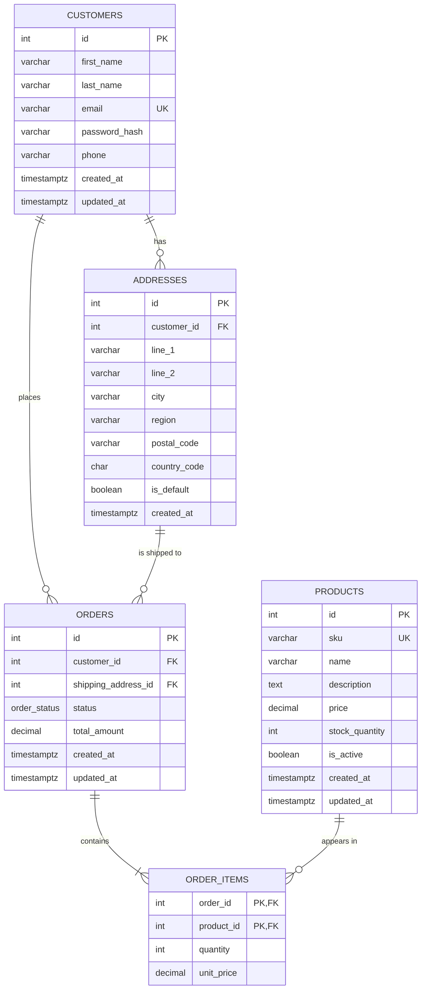

# Database Design

Target database: **PostgreSQL**.

## Entity Relationship Diagram

## How to read the diagram

Each box is a **table** (an entity). Each row inside a box is a **column**:
its type, its name, and optionally a key marker.

| Marker | Meaning |
|---|---|
| `PK` | **Primary key**: uniquely identifies each row in the table |
| `FK` | **Foreign key**: holds another table's primary key, creating a link to it |
| `UK` | **Unique key**: no two rows can share this value (e.g. two customers can't have the same email) |
| `PK, FK` | Both at once. In `order_items`, `order_id` + `product_id` together form the primary key, and each also points to another table |

The lines between boxes use **crow's foot notation**. Each end of a line shows
how many rows can sit on that side of the relationship:

| Symbol | Meaning |
|---|---|
| `\|\|` | exactly one |
| `o{` | zero or more |
| `\|{` | one or more |

So `CUSTOMERS ||--o{ ORDERS : "places"` reads as: *each order belongs to exactly
one customer, and a customer places zero or more orders.* And
`ORDERS ||--|{ ORDER_ITEMS` means every order must contain at least one item.

## Relationships

| Relationship | Cardinality | How it's stored |
|---|---|---|
| Customer → Addresses | One customer has zero or many addresses | `addresses.customer_id` |
| Customer → Orders | One customer places zero or many orders | `orders.customer_id` |
| Address → Orders | One address can be used for many orders | `orders.shipping_address_id` |
| Order ↔ Products | Many-to-many: an order holds many products, a product appears in many orders | `order_items` join table |

`order_items` isn't in the ticket's table list, but it's required: an order can't
hold a list of products in a single column, so each line of an order (product +
quantity) gets its own row.

## Tables

### customers

| Column | Type | Constraints |
|---|---|---|
| id | integer | PK, generated identity |
| first_name | varchar(100) | NOT NULL |
| last_name | varchar(100) | NOT NULL |
| email | varchar(255) | NOT NULL, UNIQUE |
| password_hash | varchar(255) | NOT NULL. Never store plain-text passwords |
| phone | varchar(30) | nullable |
| created_at | timestamptz | NOT NULL, default `now()` |
| updated_at | timestamptz | NOT NULL, default `now()` |

### addresses

| Column | Type | Constraints |
|---|---|---|
| id | integer | PK, generated identity |
| customer_id | integer | NOT NULL, FK → `customers.id`, ON DELETE CASCADE |
| line_1 | varchar(255) | NOT NULL |
| line_2 | varchar(255) | nullable |
| city | varchar(100) | NOT NULL |
| region | varchar(100) | nullable (county / state) |
| postal_code | varchar(20) | NOT NULL |
| country_code | char(2) | NOT NULL, ISO 3166 code e.g. `GB` |
| is_default | boolean | NOT NULL, default `false` |
| created_at | timestamptz | NOT NULL, default `now()` |

### products

| Column | Type | Constraints |
|---|---|---|
| id | integer | PK, generated identity |
| sku | varchar(50) | NOT NULL, UNIQUE |
| name | varchar(255) | NOT NULL |
| description | text | nullable |
| price | numeric(10,2) | NOT NULL, CHECK `price >= 0` |
| stock_quantity | integer | NOT NULL, default `0`, CHECK `stock_quantity >= 0` |
| is_active | boolean | NOT NULL, default `true` |
| created_at | timestamptz | NOT NULL, default `now()` |
| updated_at | timestamptz | NOT NULL, default `now()` |

### orders

| Column | Type | Constraints |
|---|---|---|
| id | integer | PK, generated identity |
| customer_id | integer | NOT NULL, FK → `customers.id`, ON DELETE RESTRICT |
| shipping_address_id | integer | NOT NULL, FK → `addresses.id`, ON DELETE RESTRICT |
| status | order_status (enum) | NOT NULL, default `'pending'` |
| total_amount | numeric(10,2) | NOT NULL, CHECK `total_amount >= 0` |
| created_at | timestamptz | NOT NULL, default `now()` |
| updated_at | timestamptz | NOT NULL, default `now()` |

`order_status` enum values: `pending`, `paid`, `shipped`, `delivered`, `cancelled`.

### order_items

| Column | Type | Constraints |
|---|---|---|
| order_id | integer | PK (composite), FK → `orders.id`, ON DELETE CASCADE |
| product_id | integer | PK (composite), FK → `products.id`, ON DELETE RESTRICT |
| quantity | integer | NOT NULL, CHECK `quantity > 0` |
| unit_price | numeric(10,2) | NOT NULL, CHECK `unit_price >= 0` |

## Design decisions

- **Money uses `numeric(10,2)`, not `float`.** Floating-point types can't represent
  values like `0.10` exactly, which causes rounding errors in totals.
- **`order_items.unit_price` copies the product price at checkout.** If a product's
  price changes later, past orders still show what the customer actually paid.
  `orders.total_amount` is likewise calculated once at checkout and stored.
- **Order history is protected.** Customers, addresses and products that appear on
  an order can't be deleted (`ON DELETE RESTRICT`). Retire products with
  `is_active = false` instead of deleting them.
- **Addresses used by an order shouldn't be edited in place.** Editing would change
  where past orders appear to have shipped. When a customer edits a used address,
  insert a new row instead.
- **Stock is checked and decremented in the same transaction that creates the
  order,** so two customers can't buy the last item at the same time. The
  `CHECK (stock_quantity >= 0)` constraint is a safety net if that ever fails.
- **One default address per customer** can be enforced with a partial unique index:
  `CREATE UNIQUE INDEX ON addresses (customer_id) WHERE is_default;`

## Possible later additions

- `carts` / `cart_items` tables, so a basket persists between sessions before checkout
- `billing_address_id` on `orders`, once payments are added
- `categories` table for grouping products
