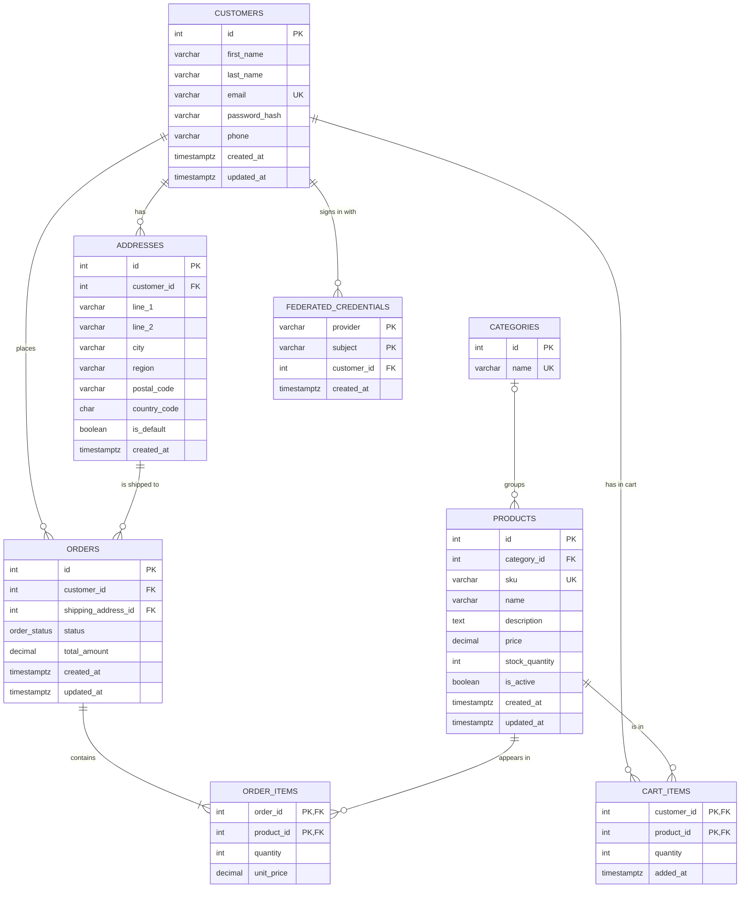
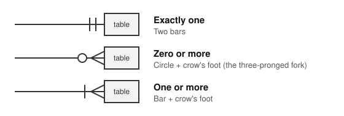

# Database Design

Target database: **PostgreSQL**.

## Entity Relationship Diagram

## How to read the diagram

Each box is a **table** (an entity). Each row inside a box is a **column**:
its type, its name, and optionally a key marker.

| Marker | Meaning |
|---|---|
| `PK` | **Primary key**: uniquely identifies each row in the table |
| `FK` | **Foreign key**: holds another table's primary key, creating a link to it |
| `UK` | **Unique key**: no two rows can share this value (e.g. two customers can't have the same email) |
| `PK, FK` | Both at once. In `order_items`, `order_id` + `product_id` together form the primary key, and each also points to another table |

The lines between boxes use **crow's foot notation**. The symbol at each end of
a line shows how many rows of the table **it touches** can be involved:

The symbols are made of two parts. Read the part nearest the table as the
**maximum** and the part further out as the **minimum**:

| Part | Means |
|---|---|
| Bar | one |
| Circle | zero (optional) |
| Crow's foot (three-pronged fork) | many |

So bar + bar = "minimum one, maximum one" = **exactly one**, and circle + crow's
foot = "minimum zero, maximum many" = **zero or more**.

**Example:** on the line between CUSTOMERS and ORDERS, the two bars touch
CUSTOMERS and the circle + crow's foot touches ORDERS. Read it from each side:
- One customer places **zero or more** orders (the symbol at the ORDERS end)
- Each order belongs to **exactly one** customer (the symbol at the CUSTOMERS end)

Similarly, the bar + crow's foot touching ORDER_ITEMS means every order must
contain **at least one** item.

| Drawn symbol | Mermaid code | Meaning |
|---|---|---|
| Two bars | `\|\|` | Exactly one |
| Circle + bar | `o\|` (or `\|o` on the left side) | Zero or one |
| Circle + crow's foot | `o{` (or `}o` on the left side) | Zero or more |
| Bar + crow's foot | `\|{` (or `}\|` on the left side) | One or more |

The Mermaid code column is only needed when editing the diagram's source. For
example, `CUSTOMERS ||--o{ ORDERS` puts two bars at the CUSTOMERS end and a
circle + crow's foot at the ORDERS end.

## Relationships

| Relationship | Cardinality | How it's stored |
|---|---|---|
| Customer → Addresses | One customer has zero or many addresses | `addresses.customer_id` |
| Customer → Orders | One customer places zero or many orders | `orders.customer_id` |
| Address → Orders | One address can be used for many orders | `orders.shipping_address_id` |
| Order ↔ Products | Many-to-many: an order holds many products, a product appears in many orders | `order_items` join table |
| Category → Products | One category groups zero or many products; a product is in zero or one category | `products.category_id` (nullable) |
| Customer ↔ Products (cart) | Many-to-many: a customer's cart holds many products, a product can be in many carts | `cart_items` join table |
| Customer → Google/Facebook accounts | One customer can be linked to zero or more provider accounts (e.g. one Google and one Facebook); each provider account links to exactly one customer | `federated_credentials.customer_id` |

`order_items` isn't in the ticket's table list, but it's required: an order can't
hold a list of products in a single column, so each line of an order (product +
quantity) gets its own row.

## Tables

### customers

| Column | Type | Constraints |
|---|---|---|
| id | integer | PK, generated identity |
| first_name | varchar(100) | NOT NULL |
| last_name | varchar(100) | NOT NULL |
| email | varchar(255) | NOT NULL, UNIQUE |
| password_hash | varchar(255) | nullable: `NULL` means the customer only signs in with Google or Facebook. A bcrypt hash; never store plain-text passwords |
| phone | varchar(30) | nullable |
| created_at | timestamptz | NOT NULL, default `now()` |
| updated_at | timestamptz | NOT NULL, default `now()` |

### federated_credentials

Links a Google or Facebook account to a customer, so they can sign in with it ("federated"
login: another service vouches for who the person is). Added by migration 003.

| Column | Type | Constraints |
|---|---|---|
| customer_id | integer | NOT NULL, FK → `customers.id`, ON DELETE CASCADE |
| provider | varchar(20) | NOT NULL, CHECK in (`'google'`, `'facebook'`) |
| subject | varchar(255) | NOT NULL. The provider's own id for the person, which never changes (even if their email does) |
| created_at | timestamptz | NOT NULL, default `now()` |

- **Primary key `(provider, subject)`:** each provider account can be linked to only one
  customer. Signing in looks the person up by this pair first.
- **Index on `customer_id`:** Postgres doesn't index foreign keys automatically; this speeds up
  finding a customer's links and the cascade when a customer is deleted.
- **Why a separate table** rather than `google_id` and `facebook_id` columns on `customers`: a
  customer can link any number of providers, and adding a provider later needs no new column.

### addresses

| Column | Type | Constraints |
|---|---|---|
| id | integer | PK, generated identity |
| customer_id | integer | NOT NULL, FK → `customers.id`, ON DELETE CASCADE |
| line_1 | varchar(255) | NOT NULL |
| line_2 | varchar(255) | nullable |
| city | varchar(100) | NOT NULL |
| region | varchar(100) | nullable (county / state) |
| postal_code | varchar(20) | NOT NULL |
| country_code | char(2) | NOT NULL, ISO 3166 code e.g. `GB` |
| is_default | boolean | NOT NULL, default `false` |
| created_at | timestamptz | NOT NULL, default `now()` |

### categories

| Column | Type | Constraints |
|---|---|---|
| id | integer | PK, generated identity |
| name | varchar(100) | NOT NULL, UNIQUE |

### products

| Column | Type | Constraints |
|---|---|---|
| id | integer | PK, generated identity |
| category_id | integer | nullable, FK → `categories.id`, ON DELETE SET NULL |
| sku | varchar(50) | NOT NULL, UNIQUE |
| name | varchar(255) | NOT NULL |
| description | text | nullable |
| price | numeric(10,2) | NOT NULL, CHECK `price >= 0` |
| stock_quantity | integer | NOT NULL, default `0`, CHECK `stock_quantity >= 0` |
| is_active | boolean | NOT NULL, default `true` |
| created_at | timestamptz | NOT NULL, default `now()` |
| updated_at | timestamptz | NOT NULL, default `now()` |

### orders

| Column | Type | Constraints |
|---|---|---|
| id | integer | PK, generated identity |
| customer_id | integer | NOT NULL, FK → `customers.id`, ON DELETE RESTRICT |
| shipping_address_id | integer | NOT NULL, FK → `addresses.id`, ON DELETE RESTRICT |
| status | order_status (enum) | NOT NULL, default `'pending'` |
| total_amount | numeric(10,2) | NOT NULL, CHECK `total_amount >= 0` |
| created_at | timestamptz | NOT NULL, default `now()` |
| updated_at | timestamptz | NOT NULL, default `now()` |

`order_status` enum values: `pending`, `paid`, `shipped`, `delivered`, `cancelled`.

### order_items

| Column | Type | Constraints |
|---|---|---|
| order_id | integer | PK (composite), FK → `orders.id`, ON DELETE CASCADE |
| product_id | integer | PK (composite), FK → `products.id`, ON DELETE RESTRICT |
| quantity | integer | NOT NULL, CHECK `quantity > 0` |
| unit_price | numeric(10,2) | NOT NULL, CHECK `unit_price >= 0` |

### cart_items

| Column | Type | Constraints |
|---|---|---|
| customer_id | integer | PK (composite), FK → `customers.id`, ON DELETE CASCADE |
| product_id | integer | PK (composite), FK → `products.id`, ON DELETE CASCADE |
| quantity | integer | NOT NULL, CHECK `quantity > 0` |
| added_at | timestamptz | NOT NULL, default `now()` |

## Design decisions

- **Money uses `numeric(10,2)`, not `float`.** Floating-point types can't represent
  values like `0.10` exactly, which causes rounding errors in totals.
- **`order_items.unit_price` copies the product price at checkout.** If a product's
  price changes later, past orders still show what the customer actually paid.
  `orders.total_amount` is likewise calculated once at checkout and stored.
- **Order history is protected.** Customers, addresses and products that appear on
  an order can't be deleted (`ON DELETE RESTRICT`). Retire products with
  `is_active = false` instead of deleting them.
- **Addresses used by an order shouldn't be edited in place.** Editing would change
  where past orders appear to have shipped. When a customer edits a used address,
  insert a new row instead.
- **Stock is checked and decremented in the same transaction that creates the
  order,** so two customers can't buy the last item at the same time. The
  `CHECK (stock_quantity >= 0)` constraint is a safety net if that ever fails.
- **One default address per customer** can be enforced with a partial unique index:
  `CREATE UNIQUE INDEX ON addresses (customer_id) WHERE is_default;`
- **A product has at most one category, and categories are optional.** Deleting a
  category doesn't delete its products: `ON DELETE SET NULL` makes them uncategorised.
  Unlike orders, nothing important is lost when a category goes.
- **Each customer has one cart, stored as `cart_items` rows.** There's no separate
  `carts` table: the customer's id identifies their cart. The composite primary key
  `(customer_id, product_id)` means each product appears once per cart, and adding it
  again raises the quantity.
- **The cart stores no price.** It always shows each product's current price. At
  checkout, each cart row is copied into `order_items` with the price at that moment,
  which freezes it for the order's history, and the cart is emptied. Retired products
  are hidden from the cart and left out of its total.
- **Carts are temporary, so they use `ON DELETE CASCADE`.** Deleting a customer or
  product deletes the matching cart rows, unlike orders, which are protected with
  `RESTRICT`.

## Possible later additions

- `billing_address_id` on `orders`, once payments are added
- A `product_categories` join table, if products ever need to be in more than one category
